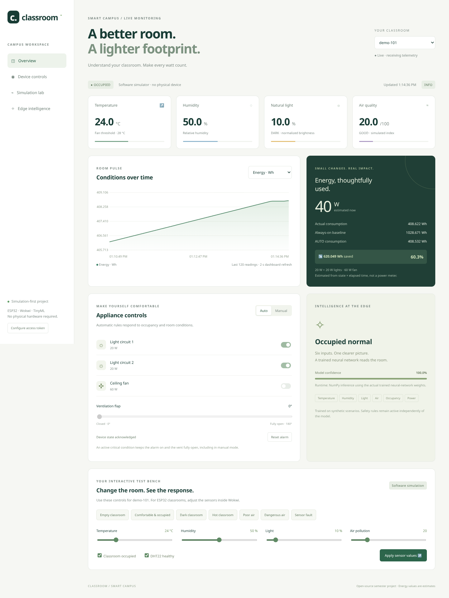
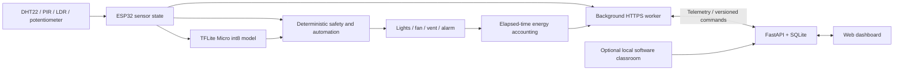

# Smart Campus Classroom Monitoring and Energy Management System

A simulation-first MCA semester project using ESP32, Wokwi, a free self-hosted dashboard, and real TensorFlow Lite Micro inference. No physical hardware or paid API is required for the local demonstration.



## What is implemented

- DHT22 temperature/humidity, PIR occupancy, LDR brightness, and potentiometer-based **simulated** air quality.
- Two lighting circuits, a fan indicator, ventilation servo, and audible critical alarm.
- AUTO/MANUAL control, emergency overrides, invalid-sensor handling, and continued local operation without cloud connectivity.
- Elapsed-time energy estimation: actual Wh/kWh, AUTO energy, always-on baseline, and estimated savings.
- A responsive web dashboard, real remote commands with acknowledgements, five charts, SQLite history, and multiple device IDs.
- A separate interactive software classroom (`demo-101`) for a completely local, account-free demonstration.
- A 6→32→24→5 neural network, 10,000-row synthetic dataset, training pipeline, int8 TFLite model, and embedded C array.
- Wireshark instructions, optional Cooja extension, test cases, viva notes, and an academic report foundation.

**Cloud choice:** the included FastAPI dashboard replaces Blynk to avoid mandatory accounts, paid datastream limits, and proprietary dependencies. Blynk is an optional documented extension, not an implemented second transport. See [cloud setup](docs/cloud_setup.md) and [Blynk mapping](docs/blynk_setup.md).

## Quick start: account-free local demonstration

Python 3.12 is recommended. Run from the repository root:

```bash
python3 -m venv .venv
.venv/bin/pip install -r requirements-dev.txt
bash scripts/run.sh
```

The server listens on loopback port 8000. Open that local server in a browser on the same computer. The dashboard immediately displays `demo-101`. Try Empty → Dark → Hot → Poor air → Dangerous air, then return to comfortable conditions and use MANUAL controls. The simulator runs the exported neural network weights, not hardcoded ML predictions. The core application has no CDN or third-party font dependency.

On Windows use `.venv\Scripts\python.exe -m uvicorn dashboard.app:app --host 127.0.0.1 --port 8000` after installing requirements with that interpreter. The Bash helper is optional.

## Architecture



The ESP32 owns its actuator state. The dashboard sends desired commands and displays the state acknowledged by the device. HTTP work runs in a separate FreeRTOS task; a network failure cannot stall the sensor/control loop.

## Technology and components

| Layer | Technology |
|---|---|
| Embedded | ESP32 DevKit v1, Arduino-ESP32 2.0.17, PlatformIO espressif32 6.10.0 |
| Simulated hardware | Wokwi DHT22, PIR, photoresistor module, potentiometer, 3 LEDs + resistors, servo, buzzer |
| Intelligence | TensorFlow 2.19, fully int8 TFLite, Chirale TensorFlow Lite Micro 2.0.0 |
| Server | Python, FastAPI, SQLite, NumPy |
| Dashboard | HTML, CSS, JavaScript, Canvas; no frontend build required |
| Verification | pytest, native C++, Playwright + Chromium |

## Pin mapping

| Device | ESP32 GPIO | Notes |
|---|---|---|
| DHT22 data | 15 | 3.3 V sensor supply |
| PIR output | 13 | Logical occupancy; PIR is not a people counter |
| LDR analog | 34 | ADC1, input-only; brightness inverts AO |
| Simulated air quality | 35 | ADC1, input-only; 0–100 index, not ppm |
| Light 1 LED | 18 | 220 Ω series resistor |
| Light 2 LED | 19 | 220 Ω series resistor |
| Fan LED | 21 | 220 Ω series resistor; represents a 60 W fan |
| Vent servo PWM | 23 | 0–180°, 5 V simulated supply |
| Buzzer | 25 | LEDC channel 14; separate from servo |

Using ADC1 avoids the ESP32 ADC2/Wi-Fi conflict. GPIO34/35 are never driven as outputs. All devices share ground. Real motors and mains appliances would require appropriate driver/isolation hardware; the circuit intentionally represents them with low-power indicators.

## Build ESP32 firmware

```bash
export PLATFORMIO_CORE_DIR=/workspace/.platformio  # optional writable cache location
.venv/bin/pio run -e esp32dev -j 4
```

The root `platformio.ini` compiles modular sources under `firmware/`. The generated model is already included. For Linux x86-64 environments where the PlatformIO registry is inaccessible, an official-release fallback is available:

```bash
.venv/bin/python scripts/build_from_sources.py
```

This verifies Espressif's published framework/compiler SHA-256 checksums and uses upstream Git repositories. Its build environment is `source-build`; output is `.pio/build/source-build/`. See [testing](docs/testing.md) for the actually verified build and remaining simulator acceptance steps.

## Wokwi setup and running the ESP32 simulation

The free **browser simulator** is the primary path. VS Code/CLI features may require a Wokwi plan or token; they are not required.

1. Open Wokwi's [ESP32 custom firmware template](https://wokwi.com/projects/305457271083631168).
2. Replace its `diagram.json` with `wokwi/diagram.json`.
3. Build and merge the firmware with the instructions in [Wokwi setup](docs/wokwi_setup.md).
4. Focus the editor, press F1, select **Upload Firmware and Start Simulation…**, and select the merged binary.
5. Observe Serial Monitor at 115200 baud. Adjust DHT22 readings, trigger PIR motion, change LDR lux, and turn the potentiometer.
6. To connect to the dashboard, provide a public HTTPS endpoint and device token in the ignored `firmware/include/secrets.h`, rebuild, and upload. The free Wokwi public gateway cannot reach your laptop's loopback interface.

The generated `wokwi/sketch.ino`, `libraries.txt`, and example secrets support browser source import as an alternative. Regenerate with `.venv/bin/python scripts/export_wokwi.py`. The merged binary route preserves the pinned Arduino core regardless of the browser compiler version.

## Credentials and hosting

```bash
.venv/bin/python scripts/create_credentials.py
```

This creates a permission-restricted, ignored `.env` containing distinct cryptographically random application tokens. Existing files are preserved. These are **application access tokens**, not Wokwi/Blynk/hosting accounts. `bash scripts/run.sh --public` loads them and listens on all interfaces; use an HTTPS reverse proxy or free hosting endpoint. No public service is created by this command. See [cloud setup](docs/cloud_setup.md).

Never upload `secrets.h`, `.env`, or a token-containing firmware binary to a public repository. Free public Wokwi projects can expose source credentials; use only disposable, restricted project tokens and rotate them afterwards.

## Train and deploy TinyML

```bash
.venv/bin/pip install -r tinyml/requirements.txt
.venv/bin/python tinyml/generate_dataset.py
.venv/bin/python tinyml/train_model.py
.venv/bin/python tinyml/convert_model.py
.venv/bin/python scripts/export_wokwi.py
```

Rebuild the firmware after model conversion. The checked-in model is 3,848 bytes and achieved **98.15% int8 accuracy on 2,000 held-out synthetic examples**. It uses per-tensor quantization compatible with the pinned Micro kernels. This is not a claim of real classroom performance. Exact splits, confusion matrix, per-class metrics, feature order, scales, and SHA-256 are recorded in `tinyml/models/metrics.json`. See [TinyML design](docs/tinyml.md).

## Tests and demonstration

```bash
.venv/bin/python -m pytest -q
g++ -std=c++17 -Wall -Wextra -Werror -Ifirmware/include tests/firmware_core.cpp -o /tmp/classroom-core-test
/tmp/classroom-core-test
npm ci
# With the local server already running, on Linux:
npm run test:browser
```

Browser tests exercise real UI interactions and save screenshots. They intentionally change `demo-101` sensor values and controls. The C++ test uses the actual firmware automation/energy headers. See [full scenario matrix](docs/testing.md), [Wireshark](docs/wireshark_analysis.md), [viva notes](docs/viva_notes.md), and [project report](report/project_summary.md).

## Limitations and future scope

Energy and air quality are estimates, not calibrated measurements. The baseline is a hypothetical continuously running 100 W load. The ESP32's counters restart on reboot; the software simulator restores its counters from SQLite. HTTP commands arrive on the next telemetry exchange (nominally 3 seconds, potentially slower in Wokwi). ML can misclassify boundary cases, so safety thresholds are independent. Optional OLED, Blynk transport, MQTT, and Cooja are not required or implemented runtime components. SQLite deployment should use a single server worker; use a shared database/message broker for production scale. Public hosting and a complete Wokwi-to-hosted-dashboard run require the user's chosen endpoint/account access and are not implied by local tests.

Future work: calibrated sensors, true occupancy estimation, scheduling, per-device credentials, data-retention policies, model retraining on real data, and [multi-node Cooja experiments](docs/cooja_extension.md).

## License

MIT for original project code. Dependency licenses remain their authors' own; TensorFlow/TFLM and Arduino dependencies retain their respective licenses.
